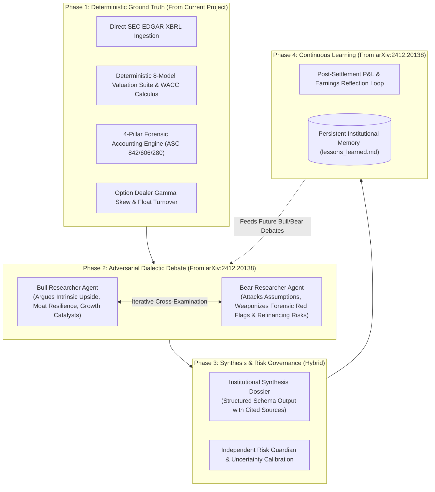

# Deep Comparative Analysis: Stock Analysis Methodology
## arXiv:2412.20138 (*TradingAgents*) vs. Current Project (*EquiSight Alpha / FinanceBlog*)

> **Scope Note:** This report strictly evaluates **Stock Analysis Methodology**—comparing how equities are identified, ingested, evaluated, stress-tested, and synthesized across both architectures. Operational concerns unrelated to stock analysis (such as web deployments, affiliate ad engines, or static site generation) are excluded.

---

## Executive Summary & Methodological Framing

| Dimension | arXiv:2412.20138 (*TradingAgents*) | Current Project (*EquiSight Alpha / FinanceBlog*) |
| :--- | :--- | :--- |
| **Primary Analytical Paradigm** | **Adversarial Agentic Trading Simulation:** Multi-agent role-playing hierarchy mimicking a quantitative hedge fund / proprietary trading desk. | **Hybrid Deterministic-Agentic Fundamental Research:** Algorithmic quantitative valuation suite paired with anti-hallucination LLM narrative synthesis. |
| **Analysis Objective** | **Actionable Execution Signals:** Produces tactical discrete trading decisions (`BUY`, `SELL`, `HOLD`), trade sizing, and order timing to maximize risk-adjusted trading alpha. | **Institutional Equity Research & Valuation:** Produces multi-page fundamental dossiers, 8-model intrinsic valuation spreads, and forensic risk audits under the Publisher's Exemption. |
| **Time Horizon** | **Tactical / Short-Term:** Daily bar resolution, momentum continuation, swing-trade risk envelopes, and post-settlement alpha tracking. | **Multi-Year / Structural:** Normalized 3-stage cash flow forecasting (5–15 year moat fade), 8-quarter EPS trends, and trailing 12-month coverage lockouts. |
| **Role of LLM** | **Autonomous Decision Maker & Debater:** LLMs act as independent analysts, adversarial debaters, risk guardians, and portfolio managers directly making execution choices. | **Qualitative Synthesizer & Communicator:** Core valuation models, solvency ratios, and forensic scores are computed deterministically in code; LLMs synthesize context, business drivers, and deduction chains. |
| **Error & Hallucination Mitigation** | **Dialectical Multi-Turn Debate:** Bull and Bear researcher agents debate opposing hypotheses in multi-turn dialogues to eliminate echo-chamber bias. | **Deterministic Code Grounding & Schema Constraints:** Parallel chunked prompting (`Part 1`, `Part 2`), deterministic fallback generation, and rule-based fact checking against raw XBRL numbers. |

---

## 1. Architectural Taxonomy & Agent Orchestration

```mermaid
flowchart TD
    subgraph TA["arXiv:2412.20138: TradingAgents Framework"]
        TA_Data["Market Feeds & Alternative Data\n(Price, News, Social, Filings)"] --> TA_Analysts["Specialized Analyst Team\n(Fundamental, Sentiment, News, Technical)"]
        TA_Analysts --> TA_Debate["Research Team Debate\n(Bullish vs. Bearish Researchers)"]
        TA_Debate --> TA_Trader["Trader Agent\n(Order Sizing & Tactical Strategy)"]
        TA_Trader --> TA_Risk["Risk Management Team\n(Exposure, Volatility, Drawdown Guard)"]
        TA_Risk --> TA_PM["Portfolio / Fund Manager\n(Execution / Rejection)"]
        TA_PM --> TA_Memory["Episodic Memory & Reflection\n(Post-Settlement P&L Learning)"]
        TA_Memory -.-> TA_Analysts
    end

    subgraph FB["Current Project: EquiSight Alpha Architecture"]
        FB_Screen["Screening & Ingestion\n(Archetype Screener: Moat, PEAD, Contrarian, Quant\nSEC EDGAR XBRL + Institutional APIs)"] --> FB_Engines["Deterministic Quantitative Engines\n- 8-Model Intrinsic Valuation Suite\n- 4-Pillar Forensic Accounting Engine\n- Morningstar Moat & Uncertainty Heuristics\n- Option Gamma & Float Liquidity Detector"]
        FB_Engines --> FB_LLM["LLM Synthesis Suite (Parallel Execution)\n- Part 1: Financials, Solvency & Trading Microstructure\n- Part 2: Moat, Multi-Model Valuation & Deduction Theses\n- Exec Summary: Star Ratings & Verdict"]
        FB_LLM --> FB_FactCheck["Anti-Hallucination Fact-Checker\n& Deterministic Failover Fallback"]
        FB_FactCheck --> FB_Output["Institutional Equity Research Report\n(Comprehensive Multi-Section Dossier)"]
    end
```



### 1.1 TradingAgents: Multi-Agent Dynamic Simulation
In arXiv:2412.20138, stock analysis is structured as an organizational workflow managed by **LangGraph**:
1. **Analyst Team:** Four discrete LLM agents run in parallel:
   - *Fundamental Analyst:* Ingests financial statements and ratios to qualitatively assess financial health.
   - *Technical Analyst:* Computes and interprets technical momentum (RSI, MACD, moving averages).
   - *Sentiment Analyst:* Evaluates market psychology across social channels (Reddit, StockTwits).
   - *News Analyst:* Evaluates breaking news, earnings surprises, and macro developments.
2. **Adversarial Research Team:** Two specialized agents—the **Bull Researcher** and **Bear Researcher**—take the analyst reports and engage in an iterative, multi-turn dialectical debate. The bull agent identifies catalysts and upside potential; the bear agent stress-tests assumptions, identifying downside risks, cyclical vulnerabilities, and liquidity constraints.
3. **Execution & Risk Layer:** A **Trader Agent** formulates an execution plan from the debate synthesis, which is reviewed by a **Risk Management Team** (evaluating portfolio VaR, maximum drawdown, and exposure limits) before the **Portfolio Manager** gives final execution approval.
4. **Episodic Reflection Loop:** Following trade execution and a holding window, a reflection mechanism calculates realized return and alpha versus a benchmark, writing a post-mortem paragraph to `trading_memory.md` to inform future agent runs.

### 1.2 Current Project: Deterministic Pipeline with Multi-Part LLM Synthesis
In this project, stock analysis is fundamentally decoupled into **deterministic numerical computation** and **agentic qualitative explanation**:
1. **Systematic Equity Screening:** Stocks enter analysis via an **Institutional Equity Selection Archetype Engine** (`pipeline/src/ingestion/archetypeScreener.ts`) rotating through 4 quantitative archetypes:
   - *Moat:* High ROIC, durable competitive advantages trading at a margin of safety.
   - *PEAD:* Post-Earnings Announcement Drift capturing earnings surprise momentum.
   - *Contrarian:* High-quality blue-chip pullbacks with temporary multiple compression.
   - *Quant:* Multi-factor composite ranking value, quality, and momentum.
2. **Deterministic Calculation Core:** Before any LLM invocation, TypeScript engines compute all valuation models, solvency metrics, and forensic indicators deterministically. No LLM is asked to perform arithmetic, calculate WACC, or compute a DCF.
3. **Parallel Two-Part LLM Synthesis:** To eliminate context degradation and hallucinations during extensive reports, analysis is partitioned into parallel prompts:
   - *Report Part 1:* Focuses on trading microstructure, balance sheet solvency, debt maturity schedules, and 8-quarter EPS trends.
   - *Report Part 2:* Focuses on 5-pillar moat evaluation, competitive benchmarking, 8-model valuation interpretation, and source-cited thesis deduction chains.
4. **Deterministic Failover Boundary:** If an LLM call fails or times out, the pipeline executes `generateDeterministicReport()`, guaranteeing mathematical integrity without hallucinated output.

---

## 2. Ingestion & Data Foundation

| Data Category | arXiv:2412.20138 (*TradingAgents*) | Current Project (*EquiSight Alpha / FinanceBlog*) | Methodological Distinction |
| :--- | :--- | :--- | :--- |
| **Financial Statements** | Ingested via financial API feeds (e.g. Yahoo Finance, Alpha Vantage) into prompt context for LLM extraction. | Direct SEC EDGAR XBRL parsing (`secXbrl.ts`) mapped to GAAP/IFRS taxonomy. | The paper relies on LLM comprehension of unstructured API responses; the project uses taxonomy-mapped XBRL fact trees with statutory standardization. |
| **Technical & Market Data** | Daily OHLCV price series, basic indicators (MACD, RSI, 20/50 DMA). | Comprehensive microstructure: Real-time price, 52-week position, volume anomaly ratio (RVOL), option gamma imbalances (dealer net gamma, call/put OI skew), and free-float concentration. | TradingAgents analyzes price purely for chart indicators; this project audits market mechanics (dealer short-gamma squeeze risk, float turnover velocity, and liquidity vacuums). |
| **Macroeconomic Context** | High-level macroeconomic news headlines ingested by the News Analyst. | Ingests 10-Year Treasury Yield (risk-free rate $R_f$), CPI/PPI inflation, Federal Reserve policy stance, VIX, and crude oil benchmarks. | TradingAgents treats macro as sentiment text; this project utilizes macro metrics mathematically to parameterize discount rates (WACC, CAPM cost of equity). |
| **Market Sentiment & Catalysts** | Social chatter from Reddit/StockTwits scraped for positive/negative polarity. | Quantified sentiment index (0–100), RVOL anomaly check, and **Catalyst-Price Alignment classification** (Aligned, Sell-the-News, Relief Rally, Macro-Dominated, Noise Speculation). | TradingAgents uses sentiment as a directional voting signal; this project cross-examines sentiment against price action to detect expectations-versus-reality divergences and artificial inflation. |

---

## 3. Fundamental, Solvency & Forensic Accounting Analysis

### 3.1 TradingAgents: Broad Qualitative Fundamentals
In arXiv:2412.20138, fundamental analysis is performed by an LLM prompt instructed to act as a financial analyst. The agent:
- Reviews revenue, net income, P/E ratio, and debt levels.
- Summarizes whether the balance sheet is healthy or strained.
- Highlights quarterly earnings beats or misses.
- **Limitation:** The depth of forensic accounting is constrained by LLM general reasoning. It does not systematically audit footnote disclosures, off-balance sheet commitments, unbilled receivables, or non-GAAP accrual distortions.

### 3.2 Current Project: 4-Pillar Forensic Accounting & Solvency Stress Testing
In contrast, this project implements a specialized **Forensic Accounting & Structural Risk Detection Engine** (`src/utils/forensicsEngine.ts`) and **Solvency Stress Test Suite** grounded in statutory accounting standards:
1. **Hidden Debt & Capital Engineering (ASC 842, ASC 440, ASC 810, Reg S-K 303):**
   - Automatically computes true adjusted debt by capitalizing operating leases and auditing footnote commitments.
   - Evaluates CapEx funding ratios (Operating Cash Flow / CapEx) to detect debt-funded reinvestment.
   - Flags net dilution share creep (>3.0% annually) masking headline share repurchases.
2. **Circular Revenue & Earnings Quality (ASC 280, ASC 606, Reg S-K 101):**
   - Audits counterparty concentration (flags single customers >10% or top-3 >30% of revenue).
   - Monitors Days Sales Outstanding (DSO) spikes (>15 days YoY) to detect aggressive revenue pull-forward.
   - Calculates unbilled receivables ratios (>12% of revenue) to identify unearned or circular revenue.
   - Evaluates average customer creditworthiness using counterparty Altman Z-Score estimates.
3. **Flawed Unit Economics & Non-GAAP Wedge (Reg G, Item 10(e)):**
   - Quantifies the **Earnings Quality Wedge**: Divergence where Non-GAAP adjusted EBITDA exceeds GAAP operating income by >25% of revenue.
   - Analyzes cloud delivery infrastructure cost scaling (compute elasticity ratio >1.25x).
   - Assesses Customer Acquisition Cost (CAC) payback periods (>18 months) and switching friction scores (<40/100).
4. **Institutional Liquidity & Multiple Disconnect (TRACE, Form 4, 13F):**
   - Tracks credit spread blowout (OAS >350 bps over Treasuries).
   - Audits Form 4 insider liquidation ratios (>4:1 sell-to-buy) and net 13F institutional retreat (>15% liquidation).
5. **Granular Debt Maturity Breakdown:**
   - Explicitly segments short-term obligations vs. long-term debt, calculating the short-to-long maturity ratio and refinancing vulnerability in high-interest environments.

---

## 4. Valuation Modeling Suite

### 4.1 TradingAgents: Heuristic & Relative Valuation
- In arXiv:2412.20138, valuation is not calculated through an explicit mathematical discounted cash flow engine.
- Instead, the Fundamental Analyst and Bull/Bear researchers evaluate valuation heuristically—referencing current multiples (P/E, P/B, EV/EBITDA) against historical norms or peer benchmarks to determine if an equity is "cheap" or "expensive."
- Valuation serves as an intermediate qualitative input to guide trade sizing rather than producing a quantitative fair value target.

### 4.2 Current Project: 8-Model Institutional Valuation Suite with Moat Fade
This project computes an 8-model deterministic valuation suite (`pipeline/src/ingestion/fundamentalData/intrinsicModels.ts`), bridging quantitative finance theory with Morningstar moat methodology:

```mermaid
graph LR
    subgraph MultiModel["8-Model Valuation Suite"]
        M1["1. Refined 3-Stage DCF\n(5Y Explicit + 5-15Y Moat Fade + Terminal PV)"]
        M2["2. Dividend Discount Model (DDM)\n(Gordon Growth with Cost of Equity)"]
        M3["3. Rapid Valuation\n(PEG Multiplier Benchmark)"]
        M4["4. Relative Valuation\n(Sector-Adjusted Peer P/E & EV/EBITDA)"]
        M5["5. Residual Income Model (RIM)\n(Edwards-Bell-Ohlson over Equity Charge)"]
        M6["6. Asset-Based Valuation\n(NAV Floor with Liquidation Haircuts)"]
        M7["7. Excess Return Model\n(EVA Spread: ROIC minus WACC)"]
        M8["8. Industry-Specific Model\n(P/FFO, EV/Sales, or Justified P/B)"]
    end

    MultiModel --> Consensus["Consensus Fair Value"]
    Consensus --> Morningstar["Morningstar Star Rating Engine\n- Uncertainty Rating (Low to Extreme)\n- 5-Star Buy Hurdle (Margin of Safety)\n- 1-Star Sell Hurdle (Overvaluation)"]
```



1. **Refined 3-Stage DCF with Competitive Moat Fade:**
   - **Stage I (Years 1–5):** Explicit cash flow projections using normalized free cash flow to firm (smoothing out CapEx lumpiness).
   - **Stage II (Years 6–10/15/20):** Moat-dependent fade period. Companies with Wide Moats fade return spreads over 15 years; Narrow Moats fade over 10 years; No Moat fades over 5 years down to the cost of capital ($WACC$).
   - **Stage III (Perpetuity):** Stable terminal growth discounted to present value.
   - **Capital Structure Bridge:** Deducts net debt (total debt minus liquid cash) from enterprise value to yield equity fair value.
2. **Seven Complementary Valuation Models:**
   - *DDM:* Evaluates dividend compounders.
   - *Rapid PEG:* Benchmarks price-earnings to growth rate.
   - *Relative Multiple:* Peer-adjusted P/E and EV/EBITDA multiples.
   - *Residual Income (Edwards-Bell-Ohlson):* Capitalizes economic earnings above equity charge.
   - *Asset-Based NAV:* Evaluates balance sheet liquidation floors under distressed scenarios.
   - *Excess Return (EVA):* Quantifies economic spread ($\text{ROIC} - \text{WACC}$).
   - *Industry-Specific Metric:* Adapts to sector characteristics (e.g. FFO multiples for real estate).
3. **Morningstar Star Rating & Uncertainty Calibration:**
   - Assigns an **Uncertainty Rating** (Low, Medium, High, Very High, Extreme) based on systematic beta, financial leverage, and operating volatility.
   - Calculates dynamic margin-of-safety buy bands (e.g., Extreme Uncertainty requires up to a 50% discount to fair value for a 5-Star rating).

---

## 5. Technical Momentum & Tactical Timing

### 5.1 TradingAgents: Technical Analysis as a Core Trading Driver
- In arXiv:2412.20138, the Technical Analyst plays a primary role. It interprets indicators (RSI, MACD, Moving Averages) to directly time order execution, generate buy/sell triggers, and set tactical stop-loss thresholds.
- Its outputs directly challenge or reinforce the Fundamental Analyst's findings during the Bull/Bear debate.

### 5.2 Current Project: Explicit Integration of TradingAgents Concepts
Interestingly, this project **explicitly incorporates the TradingAgents technical framework** (citing `arXiv:2412.20138` directly in `pipeline/src/llm/prompts.ts` at lines 42, 414, and 563, and `pipeline/src/llm/synthesisAgent.ts` line 944), but assigns it a distinctly different methodological role:
- **Secondary Tactical Subsection:** Technical analysis is scoped into a dedicated subsection ("Short-Term Tactical Momentum & Market Timing Analysis") within Section 1 of the report.
- **Four Quantitative Dimensions:**
  1. *Momentum Oscillators:* 14-day RSI (overbought >70/80 vs. oversold <30) and MACD/Stochastic crossovers.
  2. *Trend Strength:* ADX directional index (>25 trend vs. <20 chop) and Supertrend/moving average alignment.
  3. *Volatility Bands:* Bollinger Band width (volatility squeeze vs. expansion) and Average True Range (ATR) risk envelopes.
  4. *Tactical Timing Classification:* Synthesizes regimes like `MOMENTUM_EXPANSION_BULLISH`, `OVERBOUGHT_PULLBACK_RISK`, `OVERSOLD_BOUNCE_CANDIDATE`, or `RANGEBOUND_CONSOLIDATION`.
- **Methodological Role:** Rather than generating automated buy/sell orders, it provides tactical context to explain short-term price dynamics and entry/exit positioning relative to long-term fundamental fair value.

---

## 6. Synthesis, Debate, and Thesis Construction

| Dimension | arXiv:2412.20138 (*TradingAgents*) | Current Project (*EquiSight Alpha / FinanceBlog*) |
| :--- | :--- | :--- |
| **Synthesis Mechanism** | **Multi-Agent Dialectical Debate:** Bull and Bear researcher agents directly argue opposing viewpoints across iterative rounds. | **Structured Parallel Prompting & Schema Extraction:** Structured prompts generate balanced Bull and Bear cases simultaneously with explicit deduction chains. |
| **Thesis Requirements** | Generates conversational arguments regarding market trends, momentum, and business catalysts. | Mandates **Core Quality Pillars**: Vertical integration, M&A capital allocation, balance sheet resilience, customer concentration, and cyclicality. |
| **Evidence & Citations** | Synthesizes general knowledge and ingested market headlines into arguments. | Requires **Statutory Citation Chains**: Every thesis point must cite verifiable sources (10-K, 10-Q, 8-K, earnings transcripts) and provide a step-by-step deductive logic chain. |
| **Post-Analysis Learning** | **Episodic Reflection & Settlement:** Logs trades into `trading_memory.md`, evaluates realized P&L after holding periods, and provides feedback to subsequent trading sessions. | **Trailing 12-Month Coverage Lockout & Dynamic Sitemaps:** Tracks coverage history (`coverage-history.json`) to enforce 365-day lockout windows and regenerates dynamic indexing. |

---

## 7. Comparative Methodological Matrix: Comprehensive Summary

| Methodological Area | arXiv:2412.20138 (*TradingAgents*) | Current Project (*FinanceBlog / EquiSight Alpha*) |
| :--- | :--- | :--- |
| **1. Primary Objective** | Generate tactical execution decisions (`BUY`/`SELL`/`HOLD`) and optimize portfolio return/drawdown. | Deliver comprehensive, regulatory-compliant fundamental equity research and intrinsic valuation models. |
| **2. Stock Universe Selection** | Pre-selected equity tickers for backtesting and simulated trading portfolios. | Multi-tier systematic screening: 4 archetypes (Moat, PEAD, Contrarian, Quant), market movers, and SEC penny stock filters. |
| **3. Financial Calculation** | Heuristic, prompt-based estimation conducted by LLM agents. | Deterministic TypeScript math engines (zero LLM arithmetic). |
| **4. Intrinsic Valuation** | Qualitative multiples comparison; no multi-stage DCF or cost-of-capital calculus. | 8-model quantitative valuation suite with moat-dependent 3-stage fade, WACC, and CAPM. |
| **5. Forensic Risk Surveillance** | Limited to high-level balance sheet summaries and risk manager portfolio exposure limits. | 4-pillar forensic accounting engine (hidden debt, circular revenue/DSO, unit economics wedge, institutional retreat). |
| **6. Microstructure & Timing** | Technical indicators (RSI, MACD) drive order triggers and portfolio rebalancing. | Option gamma imbalances, free-float turnover, and RVOL anomalies explain price distortions; TradingAgents framework used for tactical context. |
| **7. Multi-Agent Interaction** | Sequential and cyclical multi-agent graph with adversarial Bull/Bear debates. | Linear pipeline with parallelized multi-part LLM synthesis and deterministic failover boundaries. |
| **8. Memory & Persistence** | Episodic trade logging (`trading_memory.md`) and P&L reflection loops. | Trailing 12-month coverage registry (`coverage-history.json`) and centralized financial definitions registry. |
| **9. Compliance & Output** | Simulated trade orders, position allocations, and portfolio management logs. | Institutional equity research dossiers published under Publisher's Exemption (FINRA Rule 2210 / Section 202(a)(11)(D)). |

---

## 8. Point-by-Point Evaluation: Which Approach is Better? (And Why)

Below is an objective, dimension-by-dimension institutional assessment evaluating which methodology is superior for stock analysis and why:

```
+======================================================================================================+
|                                    WHICH APPROACH IS BETTER? SCORECARD                                |
+----+-----------------------------------------+--------------------+----------------------------------+
| #  | Stock Analysis Dimension                | Superior Approach  | Key Winning Factor               |
+----+-----------------------------------------+--------------------+----------------------------------+
| 1  | Mathematical & Valuation Accuracy       | Current Project    | Deterministic code vs LLM math   |
| 2  | Data Ingestion & Statutory Precision    | Current Project    | SEC EDGAR XBRL vs Third-Party API|
| 3  | Forensic Accounting & Accounting Quality| Current Project    | 4-pillar forensic surveillance   |
| 4  | Market Microstructure & Order-Flow Risk | Current Project    | Dealer gamma & float turnover    |
| 5  | Thesis Stress-Testing & Bias Mitigation | TradingAgents      | Adversarial multi-agent debate   |
| 6  | Continuous Learning & Feedback Adaptation| TradingAgents     | Episodic P&L reflection loop     |
| 7  | Execution Sizing & Risk Management      | TradingAgents      | Dedicated portfolio risk guardian|
| 8  | Execution Speed, Latency & Reliability  | Current Project    | Parallel schema + deterministic  |
| 9  | Holistic Stock Analysis Depth           | Current Project    | Multi-model intrinsic synthesis  |
+----+-----------------------------------------+--------------------+----------------------------------+
```

---

### Point 1: Mathematical Valuation & Intrinsic Pricing
* **Verdict:** **Current Project (*EquiSight Alpha*) is significantly better.**
* **Why:** Large Language Models are probabilistic next-token predictors that struggle with multi-step arithmetic, floating-point compounding, discounting formulas, and capital structure bridges. Entrusting DCF, WACC, and terminal value computations to an LLM prompt (as in *TradingAgents*) frequently produces hallucinated discount rates, mathematical inconsistencies, and un-auditable outputs. In *EquiSight Alpha*, all 8 valuation models (3-Stage DCF with moat fade, DDM, PEG, RIM, NAV liquidation, EVA spread, and sector multiples) are evaluated **deterministically in TypeScript math engines**. The LLM receives pre-calculated, verified numbers and is only tasked with synthesizing qualitative commentary. For institutional stock valuation, deterministic code is unconditionally superior.

---

### Point 2: Ingestion & Regulatory Ground-Truth Foundation
* **Verdict:** **Current Project (*EquiSight Alpha*) is better.**
* **Why:** *TradingAgents* relies on general financial APIs (Yahoo Finance, Alpha Vantage) feeding summarized data into prompt windows. This introduces reliance on third-party data aggregators that often adjust GAAP numbers inconsistently or omit crucial footnote details. *EquiSight Alpha* ingests direct **SEC EDGAR XBRL taxonomy trees** (`secXbrl.ts`) directly from statutory 10-K and 10-Q filings, supplemented by standardized macro indicators ($R_f$, VIX, CPI) to parametrize discount rates. Direct regulatory filing ingestion ensures empirical integrity and auditability.

---

### Point 3: Forensic Accounting & Balance Sheet Stress Testing
* **Verdict:** **Current Project (*EquiSight Alpha*) is significantly better.**
* **Why:** In *TradingAgents*, fundamental analysis is a high-level summary of reported revenue, net income, and P/E ratios. It lacks the ability to uncover balance sheet manipulation or structural accounting red flags. *EquiSight Alpha* incorporates a dedicated **4-Pillar Forensic Accounting Engine** (`forensicsEngine.ts`) that programmatically audits:
  1. *Hidden Debt & Capital Engineering:* Capitalizing operating leases (ASC 842), footnote purchase obligations (ASC 440), and net dilution share creep.
  2. *Circular Revenue:* Counterparty concentration (ASC 280), Days Sales Outstanding (DSO) spikes (>15 days YoY), and unbilled contract assets.
  3. *Unit Economics & Quality Wedge:* Non-GAAP EBITDA exceeding GAAP Operating Income by >25% of revenue (Reg G), and CAC payback inflation.
  4. *Institutional Retreat:* Credit default OAS spread blowouts and Form 4 insider liquidation ratios.
  
  For identifying existential solvency risks and earnings manipulation before they cause catastrophic capital loss, *EquiSight Alpha* is vastly superior.

---

### Point 4: Market Microstructure & Reflexive Liquidity Risk
* **Verdict:** **Current Project (*EquiSight Alpha*) is better.**
* **Why:** *TradingAgents* relies on traditional technical indicators (RSI, MACD, moving averages), which are lagging indicators derived solely from historical price bars. *EquiSight Alpha* audits **underlying structural liquidity**: dealer option gamma exposure (identifying when market makers are short gamma and forced to buy into rallies or sell into declines), call/put open interest skew, and free-float turnover velocity. In modern markets dominated by systematic options hedging and retail cornering, analyzing dealer gamma and float concentration detects reflexive short squeezes and liquidity vacuums that chart oscillators cannot see.

---

### Point 5: Hypothesis Stress-Testing & Confirmation Bias Mitigation
* **Verdict:** **arXiv:2412.20138 (*TradingAgents*) is significantly better.**
* **Why:** This is the core architectural innovation of *TradingAgents*. Single LLM prompts (even when prompted to provide "balanced bull and bear cases") suffer from passive tone-matching, confirmation bias, and superficial counter-arguments. By implementing an **adversarial multi-agent dialectic** between a dedicated **Bull Researcher** and a **Bear Researcher** within a LangGraph state machine, *TradingAgents* forces conflicting theses to collide over multiple rounds of structured debate. The bear agent actively attacks the bull agent's assumptions, exposing vulnerabilities, cyclical headwinds, and valuation fragility. *EquiSight Alpha* generates both bull and bear cases in a single prompt pass, which lacks the adversarial tension and multi-turn rigor of a true debate.

---

### Point 6: Continuous Learning, Feedback Adaptation & Memory
* **Verdict:** **arXiv:2412.20138 (*TradingAgents*) is significantly better.**
* **Why:** *TradingAgents* features an **Episodic Reflection Loop**. After a stock trade is simulated and the holding period elapses, the system computes realized alpha versus a benchmark, formulates a natural-language reflection analyzing why the thesis succeeded or failed, and logs this into persistent memory (`trading_memory.md`). Subsequent analyst and portfolio manager runs read this memory log, creating a genuine continuous improvement loop. *EquiSight Alpha* has no performance feedback mechanism; its history tracking (`coverage-history.json`) is merely an administrative 12-month lockout window to avoid publishing duplicate reports. It does not evaluate whether past valuation verdicts proved accurate or update its reasoning based on realized market outcomes.

---

### Point 7: Risk Management & Portfolio Execution Governance
* **Verdict:** **arXiv:2412.20138 (*TradingAgents*) is better for Active Trading; Current Project is better for Margin-of-Safety Valuation.**
* **Why:**
  * For **active portfolio execution**, *TradingAgents* is superior: It separates the Trader from the **Risk Management Team** (evaluating portfolio-level Value at Risk, volatility exposure, and maximum drawdown constraints across conservative, moderate, and aggressive profiles) and a **Fund Manager** who possesses ultimate veto authority. This multi-layered separation of duties mimics institutional compliance and prevents rogue position sizing.
  * For **fundamental margin-of-safety analysis**, *EquiSight Alpha* is superior: It maps uncertainty directly to Graham & Dodd and Morningstar margin-of-safety hurdle rates (calibrating buy/sell bands based on operating volatility and financial leverage).
  * *Overall:* For autonomous agent governance, *TradingAgents*' dedicated risk manager agent and portfolio-level gatekeeping represent a more advanced systemic architecture.

---

### Point 8: Execution Reliability, Latency & Hallucination Containment
* **Verdict:** **Current Project (*EquiSight Alpha*) is significantly better.**
* **Why:** *TradingAgents*' complex cyclic graph requires extensive multi-turn LLM calls across 7+ distinct agents (Fundamental, Sentiment, News, Technical, Bull, Bear, Trader, Risk Guardian, Fund Manager). This introduces severe latency, high API costs, cumulative failure points, and the risk of conversational drift or deadlock. *EquiSight Alpha* utilizes **parallelized, decoupled LLM calls** (`Part 1`, `Part 2`, and `Exec Summary`) governed by strict Zod JSON schemas, backed by an automated rule-based fact-checker, and supported by an **instantaneous deterministic fallback engine** (`generateDeterministicReport()`). If an API fails or an LLM hallucinates, the pipeline seamlessly falls back to pre-computed institutional reports.

---

### Point 9: Holistic Depth of Stock Analysis
* **Verdict:** **Current Project (*EquiSight Alpha*) is better.**
* **Why:** When evaluating which system produces a more complete, rigorous, and actionable fundamental understanding of an enterprise:
  * *TradingAgents* produces a tactical trading signal (`BUY 200 shares AAPL, target $235, stop $220`) supported by high-level analyst bullet points. It does not explain how the company makes money across segments, does not deconstruct competitive advantages into Morningstar's 5 moat pillars, does not model 15-year return fade spreads, and does not audit contract asset accounting.
  * *EquiSight Alpha* provides an end-to-end institutional equity thesis: segment revenue dynamics, debt maturity ladders, 4-pillar forensic audits, 8-model valuation spreads, peer competitor benchmarking, and tactical momentum timing (borrowed directly from arXiv:2412.20138).

---

## 9. Synthesis: How the Ideal Stock Analysis System Would Combine Both

The ideal institutional stock analysis methodology combines the strengths of both systems:



1. **Adopt from the Current Project:** Keep all financial arithmetic, DCF valuation, forensic accounting checks, and SEC XBRL ingestion **strictly deterministic in code**. Never delegate financial calculations to an LLM.
2. **Adopt from arXiv:2412.20138:** Upgrade the qualitative thesis generation from a single prompt pass to an **adversarial multi-agent Bull vs. Bear debate**, arming the Bear agent with the deterministic forensic red flags to aggressively stress-test the investment case.
3. **Adopt from arXiv:2412.20138:** Implement a **continuous reflection loop** that tracks subsequent earnings reports and price trajectories against the valuation verdict, logging post-mortem critiques to iteratively refine the agent's analytical judgment.
