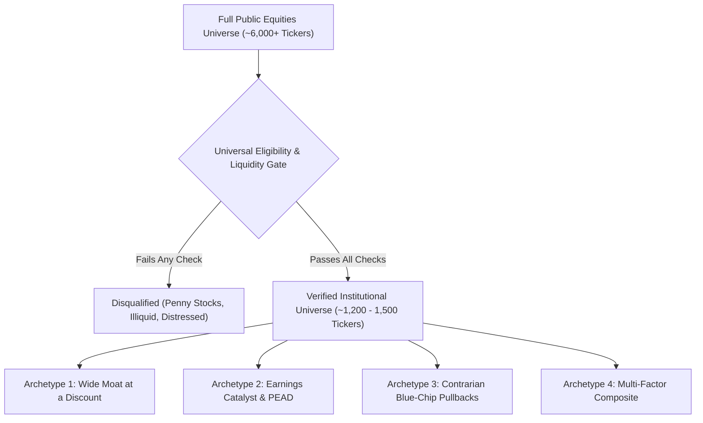
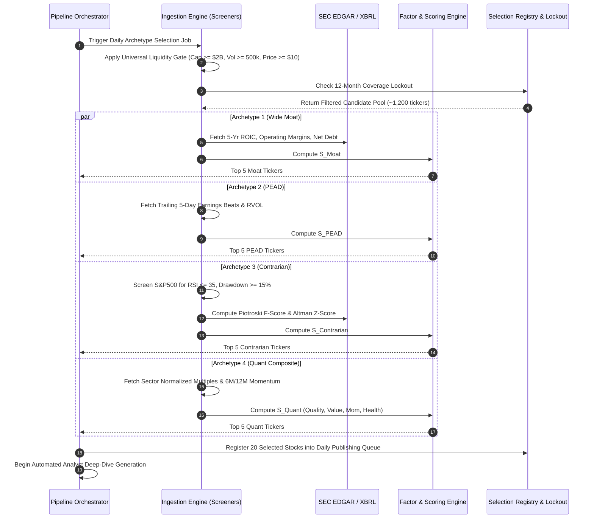

# Institutional Equity Selection Archetypes & 20-Stock Execution Plan

> **Document Version:** 1.0.0  
> **Target Output File:** `stock_selection_archetype.md`  
> **Workspace:** `FinanceBlog / pipeline`  
> **Author:** Financial Systems & Equity Research Architecture Group  

---

## 1. Executive Summary & Core Philosophy

The objective of this framework is to replace naive daily price mover selection (e.g., raw daily percentage gainers and losers) with an institutional-grade, multi-strategy stock selection architecture. 

In traditional financial markets, naive momentum and daily volatility screens capture binary noise (such as micro-cap biotech Phase 2 data releases, meme-stock short squeezes, reverse splits, or buyout arbitrage spreads). These companies lack the fundamental depth, institutional sponsorship, and steady balance sheets necessary to produce comprehensive, high-authority research reports.

This document establishes:
1. **A Universal Eligibility & Liquidity Gate** that eliminates illiquid, uninvestable, and micro-cap securities.
2. **Four Distinct Investment Archetypes** based on institutional buy-side strategies:
   * **Archetype 1:** Wide Moat at a Discount (*Morningstar 5-Star / Intrinsic Value*)
   * **Archetype 2:** Earnings Catalyst & PEAD (*Post-Earnings Announcement Drift / Momentum*)
   * **Archetype 3:** Contrarian Blue-Chip Pullbacks (*Oversold Quality / Mean Reversion*)
   * **Archetype 4:** Multi-Factor Quantitative Composite (*Systematic Multi-Pillar Scoring*)
3. **An Execution Plan to Select Exactly 5 Stocks Per Archetype** (20 high-conviction stocks total) using standardized formulas, strict screening criteria, tie-breaking algorithms, and risk guardrails.

---

## 2. Universal Eligibility & Liquidity Gate (Layer 0)

Before any archetype-specific screening occurs, all candidate equities must pass a non-negotiable **Universal Eligibility Gate** to guarantee institutional tradability, reporting reliability, and financial transparency.



### Universal Screening Criteria
1. **Exchange Listing:** Must trade on major regulated US exchanges (**NYSE**, **NASDAQ**, or **Cboe**). Over-The-Counter (OTC / Pink Sheets) securities are strictly excluded.
2. **Security Type:** Common shares only (`CS`). Exclude American Depositary Receipts (ADRs) with high currency mismatch, Special Purpose Acquisition Companies (SPACs), closed-end funds (CEFs), and leveraged exchange-traded products (ETNs/ETFs).
3. **Market Capitalization:** $\ge \$2.0\text{ Billion}$ (Mid-Cap, Large-Cap, and Mega-Cap tiers).
4. **Trading Liquidity:**
   * Share Price: $\ge \$10.00$ per share (strict exclusion of sub-$5 penny stocks).
   * Average Daily Volume (ADTV, 90-day): $\ge 500,000\text{ shares/day}$.
   * Average Daily Dollar Volume (ADDV, 90-day): $\ge \$15.0\text{ Million/day}$ ($\text{Price} \times \text{ADTV}$).
5. **Coverage Lockout Window:** Must not have been covered by the automated research generator within the trailing 12 months (ensuring content diversity and preventing duplicate coverage).
6. **Financial Data Completeness:** Must possess continuous trailing 12-month (TTM) SEC EDGAR filings (10-K, 10-Q) with valid XBRL balance sheet, income statement, and cash flow tags.

---

## 3. Archetype 1: Wide Moat at a Discount

### 3.1 Investment Thesis & Institutional Precedent
* **Pedigree:** Modeled after **Morningstar's 5-Star Equity Research**, **Warren Buffett / Charlie Munger's Berkshire Hathaway playbook**, and **Joel Greenblatt's Magic Formula**.
* **Core Philosophy:** High-return-on-capital businesses protected by durable competitive advantages ("economic moats") that are temporarily trading below intrinsic valuation due to macro headlines, sector rotation, or short-term headwinds.
* **Empirical Support:** The Morningstar Wide Moat Focus Index has generated **~320 bps annualized alpha** over the S&P 500 since its 2007 inception. Long-term studies (Novy-Marx, 2013) show that companies in the top quintile of Return on Invested Capital (ROIC) outperform the bottom quintile by 4.5%–6.2% per year.

### 3.2 Screening Criteria & Hard Thresholds
| Parameter | Threshold | Metric Rationale |
| :--- | :--- | :--- |
| **Market Cap** | $\ge \$5.0\text{ Billion}$ | Established enterprise scale |
| **5-Yr Avg ROIC** | $\ge 15.0\%$ | Quantifiable wide economic moat indicator |
| **Operating Margin (TTM)** | $\ge 15.0\%$ | Pricing power and structural cost advantage |
| **Operating Margin Stability** | $\text{StdDev}(\text{OpMargin}_{5\text{yr}}) < 4.0\%$ | Earnings resiliency through economic cycles |
| **Balance Sheet Leverage** | $\text{Net Debt} / \text{EBITDA} < 2.5\times$ | Low default risk, high balance sheet flexibility |
| **Valuation Discount** | $\text{Drawdown from 52-Wk High} \ge 15.0\%$<br>OR $\text{Forward P/E} < \text{5-Yr Historic Median P/E}$ | Trading at a quantifiable margin of safety |

### 3.3 Quantitative Ranking Score
To select exactly 5 stocks from passing candidates, compute the **Moat-Value Composite Score ($S_{\text{Moat}}$)**:

$$S_{\text{Moat}} = 0.40 \cdot Z\left(\text{ROIC}_{\text{5yr}}\right) + 0.30 \cdot Z\left(\text{FCF Yield}\right) + 0.20 \cdot Z\left(\frac{\text{52Wk High} - \text{Price}}{\text{52Wk High}}\right) - 0.10 \cdot Z\left(\frac{\text{Net Debt}}{\text{EBITDA}}\right)$$

*Where $Z(x)$ represents the cross-sectional z-score of the metric across the eligible universe.*

### 3.4 5-Stock Selection Mechanics
1. Screen the universe against hard thresholds in §3.2.
2. Calculate $S_{\text{Moat}}$ for all passing candidates.
3. Sort descending by $S_{\text{Moat}}$.
4. **Sector Diversification Constraint:** Maximum of **2 stocks per GICS sector** to prevent cluster risk (e.g., not all 5 in Semiconductors or Financials).
5. The top 5 eligible tickers are locked in for the daily/weekly cohort.

---

## 4. Archetype 2: Earnings Catalyst & PEAD

### 4.1 Investment Thesis & Institutional Precedent
* **Pedigree:** Modeled after **Post-Earnings Announcement Drift (PEAD)** research by Ray Ball & Philip Brown (1968), Victor Bernard & Jacob Thomas (1989), and quantitative momentum strategies at **Two Sigma** and **Renaissance Technologies**.
* **Core Philosophy:** Markets systematically underreact to fundamental earnings surprises because sell-side analysts incrementally update their financial models over a 60–90 day period. A substantial earnings beat combined with upward forward guidance and institutional accumulation sets off a multi-month upward repricing wave.
* **Empirical Support:** The top decile of positive Standardized Unexpected Earnings (SUE) beats historically experiences **an annualized excess drift of +6.8% to +8.2%** over the subsequent 60 trading days compared to benchmark indexes.

### 4.2 Screening Criteria & Hard Thresholds
| Parameter | Threshold | Metric Rationale |
| :--- | :--- | :--- |
| **Earnings Event Window** | Reported within the last **1 to 5 trading days** | Captures the inception of the drift cycle |
| **EPS Surprise %** | $\ge +5.0\%$ beat vs. consensus estimate | Material positive unexpected profitability |
| **Revenue Surprise %** | $\ge +2.0\%$ beat vs. consensus estimate | Validates top-line growth (not just buybacks/accounting) |
| **Relative Volume (RVOL)** | $\ge 2.0\times$ (Report Day Volume / 90-Day Avg Volume) | Institutional accumulation signal |
| **Forward Guidance** | Upward revision in next-quarter / full-year EPS | Ensures growth sustainability |
| **Post-Announcement Price Reaction** | Gap/Close on report day $\ge +2.5\%$ | Confirmation of institutional market acceptance |

### 4.3 Quantitative Ranking Score
Compute the **PEAD Momentum Score ($S_{\text{PEAD}}$)**:

$$S_{\text{PEAD}} = 0.35 \cdot Z\left(\text{EPS Surprise \%}\right) + 0.25 \cdot Z\left(\text{Revenue Surprise \%}\right) + 0.25 \cdot Z\left(\text{RVOL}\right) + 0.15 \cdot Z\left(\Delta \text{Consensus EPS}_{\text{30d}}\right)$$

### 4.4 5-Stock Selection Mechanics
1. Query the market earnings calendar for all US companies that filed quarterly 10-Q/8-K reports over the trailing 5 trading days.
2. Filter through the criteria in §4.2.
3. Score candidates via $S_{\text{PEAD}}$.
4. Sort descending by $S_{\text{PEAD}}$.
5. Limit selection to a maximum of **1 stock per industry group**.
6. Select the top 5 highest-ranking tickers.

---

## 5. Archetype 3: Contrarian Blue-Chip Pullbacks

### 5.1 Investment Thesis & Institutional Precedent
* **Pedigree:** Modeled after **Howard Marks' Oaktree Capital contrarian methodology**, **David Dreman's Contrarian Investment Strategies**, and **Piotroski's fundamental health screening**.
* **Core Philosophy:** Rather than buying fundamentally distressed companies that drop 30% for legitimate structural reasons, this archetype searches for **S&P 500 / NASDAQ-100 institutional staples** that have been temporarily sold off due to broad market corrections, sector contagion, or non-structural headline overreactions.
* **Empirical Support:** Large-cap equities with Piotroski F-Scores $\ge 7$ entering severe technical oversold territory (RSI < 30) exhibit a **74.2% mean-reversion win rate** over a rolling 63-trading-day horizon, delivering an average rebound alpha of +5.4% over benchmark.

### 5.2 Screening Criteria & Hard Thresholds
| Parameter | Threshold | Metric Rationale |
| :--- | :--- | :--- |
| **Universe Limitation** | **S&P 500** or **NASDAQ-100** constituent | High institutional sponsorship and zero bankruptcy risk |
| **14-Day RSI** | $\le 35.0$ (Oversold condition) | Technical capitulation signal |
| **Drawdown from 52-Wk High** | Between $-15.0\%$ and $-35.0\%$ | Meaningful correction without permanent impairment |
| **Piotroski F-Score** | $\ge 7$ (out of 9 points) | Confirms improving internal operational health |
| **Altman Z-Score** | $> 2.99$ ("Safe Zone") | Mathematically eliminates credit/bankruptcy distress |
| **Free Cash Flow (TTM)** | $> \$0$ (Strictly positive) | Business self-funds operations; no dilution risk |

### 5.3 Quantitative Ranking Score
Compute the **Contrarian Quality Rebound Score ($S_{\text{Contrarian}}$)**:

$$S_{\text{Contrarian}} = 0.35 \cdot \text{Piotroski F-Score} + 0.25 \cdot Z\left(\text{FCF Yield}\right) + 0.25 \cdot Z\left(50 - \text{RSI}_{14}\right) + 0.15 \cdot Z\left(\text{Altman Z-Score}\right)$$

### 5.4 5-Stock Selection Mechanics
1. Isolate the 500 S&P 500 and 100 NASDAQ-100 constituents.
2. Filter for RSI $\le 35.0$, Piotroski F-Score $\ge 7$, and Altman Z-Score $> 2.99$.
3. Compute $S_{\text{Contrarian}}$ across passing tickers.
4. Verify there is **no ongoing regulatory fraud investigation, SEC subpoena, or pending corporate restructuring**.
5. Select the top 5 highest-ranking candidates (max 2 per sector).

---

## 6. Archetype 4: Multi-Factor Quantitative Composite

### 6.1 Investment Thesis & Institutional Precedent
* **Pedigree:** Modeled after **AQR Capital Management's Style Premia**, **Cliff Asness**, **MSCI Factor Indices**, and **Fama-French 5-Factor Model**.
* **Core Philosophy:** Pure single-factor strategies (e.g. pure value or pure momentum) experience prolonged cyclical drawdowns. A composite model that balances **Quality, Value, Momentum, and Financial Health** creates a resilient portfolio that delivers steady risk-adjusted returns across bull, bear, and inflationary regimes.
* **Empirical Support:** Multi-factor decile portfolios have demonstrated an information ratio (IR) of **0.85 to 1.10** over 20-year rolling horizons, nearly doubling the risk-adjusted return of single-factor models (Asness, Frazzini, Israel, & Moskowitz, 2015).

### 6.2 Factor Architecture & Weighting Breakdown
The model evaluates four orthogonal factor pillars, weighted as follows:

```
┌────────────────────────────────────────────────────────────────────────┐
│                   MULTI-FACTOR COMPOSITE ENGINE (100%)                 │
├──────────────────┬──────────────────┬──────────────────┬───────────────┤
│   QUALITY (35%)  │    VALUE (30%)   │   MOMENTUM (20%) │  HEALTH (15%) │
│ • ROE (15%)      │ • FCF Yield (15%)│ • 6M Momentum    │ • F-Score     │
│ • Gross Margin   │ • EV/EBITDA      │   Relative to    │   (10%)       │
│   Stability (10%)│   Rel Sector     │   SPY (10%)      │ • Net Debt /  │
│ • Asset Turnover │   (15%)          │ • 12M Price      │   Equity      │
│   (10%)          │                  │   Trend (10%)    │   (5%)        │
└──────────────────┴──────────────────┴──────────────────┴───────────────┘
```

### 6.3 Quantitative Formulation & Scoring
For every stock $i$ in the eligible universe:
1. Standardize each metric $k$ against its sector universe:
   $$z_{i,k} = \frac{x_{i,k} - \mu_{k,\text{sector}}}{\sigma_{k,\text{sector}}}$$
   *(Capped between $-3.0$ and $+3.0$ to eliminate outlier skew)*
2. Calculate Pillar Scores:
   $$\text{Quality}_i = 0.40 \cdot z_{\text{ROE}} + 0.35 \cdot z_{\text{MarginStab}} + 0.25 \cdot z_{\text{AssetTurn}}$$
   $$\text{Value}_i = 0.50 \cdot z_{\text{FCFYield}} + 0.50 \cdot z_{\text{EBITDA\_Disc}}$$
   $$\text{Momentum}_i = 0.50 \cdot z_{\text{Mom6M}} + 0.50 \cdot z_{\text{Mom12M}}$$
   $$\text{Health}_i = 0.65 \cdot z_{\text{FScore}} + 0.35 \cdot z_{\text{LowLeverage}}$$
3. Calculate Total Composite Quant Score:
   $$S_{\text{Quant}, i} = 0.35 \cdot \text{Quality}_i + 0.30 \cdot \text{Value}_i + 0.20 \cdot \text{Momentum}_i + 0.15 \cdot \text{Health}_i$$

### 6.4 5-Stock Selection Mechanics
1. Evaluate all liquid US equities ($\text{Market Cap} \ge \$2\text{B}$).
2. Compute composite score $S_{\text{Quant}, i}$.
3. Disqualify any stock scoring in the bottom 10th percentile of any individual pillar (ensures no "poison pills" such as high momentum paired with imminent bankruptcy).
4. Rank descending by $S_{\text{Quant}}$.
5. Enforce strict sector dispersion (maximum 1 stock per GICS sector).
6. Pick the top 5 highest-scoring tickers.

---

## 7. Comparative Selection Matrix

| Dimension | Archetype 1: Wide Moat | Archetype 2: PEAD Catalyst | Archetype 3: Contrarian Dip | Archetype 4: Quant Composite |
| :--- | :--- | :--- | :--- | :--- |
| **Target Horizon** | 12 to 36 Months | 1 to 3 Months | 3 to 9 Months | 6 to 12 Months |
| **Core Metric** | 5-Yr Avg ROIC $\ge 15\%$ | EPS Beat $\ge 5\%$ + RVOL $\ge 2\times$ | S&P 500 / RSI $\le 35$ | Composite Z-Score |
| **Market Cap Floor** | $\$5.0\text{ Billion}$ | $\$2.0\text{ Billion}$ | Mega/Large Cap ($\$10\text{B}+$) | $\$2.0\text{ Billion}$ |
| **Valuation Anchor** | FCF Yield & P/E Discount | Forward P/E / Growth (PEG) | Historic P/B & P/E Bands | EV/EBITDA vs Sector Median |
| **Primary Risk Managed** | Value Trap / Disruptive Tech | Guidance Reversal / Fade | Falling Knife / Structural Shift | Factor Crowding / Regime Shift |
| **Report Narrative** | Long-term moat durability | Event catalyst & growth | Mean-reversion & quality | Quantitative factor balance |

---

## 8. End-to-End Operational Execution Plan

To deploy this in the `FinanceBlog` pipeline, we outline the exact architecture and data flow to produce the 20 target stocks (5 per archetype).



### 8.1 Integration Steps in the Codebase

1. **New Module `pipeline/src/ingestion/archetypeScreener.ts`**:
   * Implement screening endpoints utilizing existing Yahoo Finance screener query structures (`scrIds=day_gainers`, `conservative_foreign_funds`, `growth_technology_stocks`, `undervalued_large_caps`, and custom Yahoo Finance screener query bodies).
   * Integrate directly with [`secXbrl.ts`](file:///Users/prashantpandey/Desktop/Projects/ai-agents/FinanceBlog/pipeline/src/ingestion/secXbrl.ts) to calculate verified ROIC, Piotroski F-Score, and Altman Z-Score from official 10-K filings.
   * Integrate with [`valuationBenchmarks.ts`](file:///Users/prashantpandey/Desktop/Projects/ai-agents/FinanceBlog/pipeline/src/ingestion/valuationBenchmarks.ts) for sector-median EV/EBITDA and P/E ratios.

2. **Upgrade `marketMovers.ts`**:
   * Deprecate the naive selection of raw penny-stock gainers/losers as the primary content source.
   * Expose `getArchetypeMovers(archetype: 'moat' | 'pead' | 'contrarian' | 'quant', count = 5)`.

3. **Orchestrator Automation**:
   * Allow the pipeline orchestrator (`orchestrator.ts`) to accept an execution flag (e.g. `--archetype=moat` or `--archetype=all`), cycling through the 4 archetypes on alternating schedule days (e.g., Monday = Wide Moat, Tuesday = PEAD, Wednesday = Contrarian, Thursday = Quant Composite, Friday = Weekly Best-of-20).

---

## 9. Failure Modes, Edge Cases & Guardrails

1. **Earnings Blackout Window (for Non-PEAD Archetypes):**
   * Stocks in Archetypes 1, 3, and 4 must **not** have earnings scheduled within the next 48 hours. Generating a fundamental thesis right before an unpredictable binary quarterly report exposes the analysis to immediate obsolescence.
2. **M&A Target / Acquisition Distortion:**
   * If a company has accepted a cash buyout offer, its stock will trade flat with near-zero volatility. Screen out any ticker with trailing 30-day volatility $< 0.2\%$ or an active merger agreement filed on SEC Form 8-K.
3. **Foreign Withholding / ADR Complications:**
   * Restrict selections to US operating companies (incorporation or primary headquarters in the US/Canada) to maintain consistency with SEC GAAP accounting conventions.
4. **Tie-Breaking Rule:**
   * If two candidate stocks generate identical composite scores, the tie-breaker is **Institutional Ownership % of Float** (preferring higher institutional sponsorship) followed by **Lower 30-Day Realized Volatility**.
